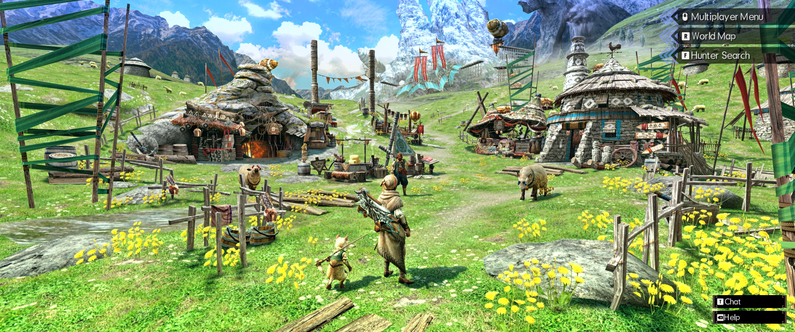
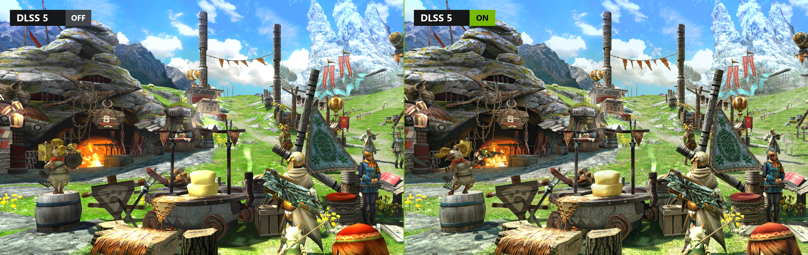
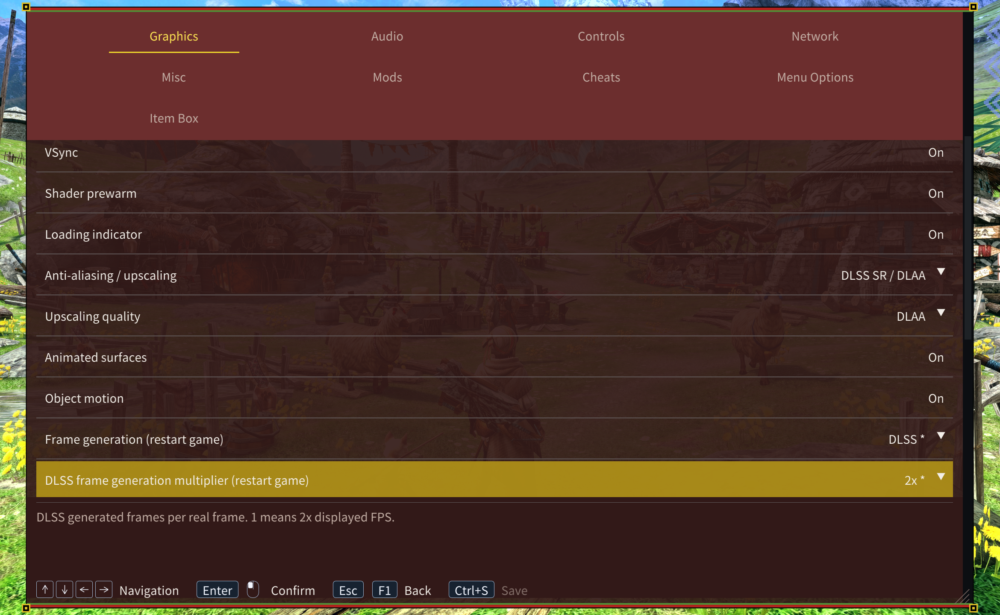

<h1 align="center">MHGURecomp Enhanced</h1>

<p align="center"><strong>English</strong> · <a href="docs/README.zh-CN.md">简体中文</a> · <a href="docs/README.zh-TW.md">繁體中文</a></p>

Built on [morerokk/MHGURecomp](https://github.com/morerokk/MHGURecomp), this enhanced Windows edition adds **native keyboard/mouse input and icon support, ultrawide support, DLSS Super Resolution and DLSS 5 Neural Rendering**.

[VERSION](VERSION) is the Enhanced version. [UPSTREAM_VERSION](UPSTREAM_VERSION) is the upstream release used as its integration baseline.

## Requirements and installation

- Windows 10/11 (64-bit), an AVX2/FMA CPU, a Vulkan 1.2 GPU, at least 4 GB RAM and 1 GB VRAM for the base renderer.
- A complete Nintendo Switch MHGU 1.4.0 dump with the update merged.

Download `MHGURecomp-Enhancement-win_x86-64.zip` from [Releases](https://github.com/dzxrly/MHGURecomp-Enhanced/releases), extract it, then place both complete game folders here:

```text
Windows-MHGURecomp/
  mhgurecomp.exe
  mhgugame.dll
  mhgurecomp-updater.exe
  data/
    exefs/
    romfs/
  mods/Keyboard_Mouse_Input_Auto/
```

Keep all program dependencies from the archive. Start `mhgurecomp.exe`; the first start creates `mhgurecomp.ini`. Startup checks the supported game version. Keep the base game files unchanged and install changes through mods.

## Ultrawide support

Open **F1 → Graphics → Aspect ratio**. **Auto** follows the output resolution. The presets include 16:10, 16:9, 21:9, 32:10 and 32:9, plus exact ratios for common ultrawide screens.

| Output resolution | Preset |
| --- | --- |
| 2560×1080 | 64:27 |
| 3440×1440 | 43:18 |
| 3840×1600 | 24:10 |

Wider ratios show more of the scene on both sides at the same vertical field of view. Use **HUD anchor** to keep the HUD in the central **16:9** area or move it to the **Edges**. Save to apply both settings. Pre-recorded movies keep their original aspect ratio.

[](docs/screenshots/en/ultrawide.webp)

## Graphics and neural rendering

- **Anti-aliasing / upscaling** offers FXAA, MSAA, FSR 3.1, FSR 4, XeSS SR and DLSS SR / DLAA. MSAA is unavailable while neural rendering or frame generation is active. FSR 4 falls back to FSR 3.1 when needed. F1 reports the active backend and render size.
- **Frame generation** offers FSR or DLSS. Save and restart after changing the backend or DLSS multiplier. **Frame rate limit** caps rendered frames. **Performance overlay** shows presented and rendered frame rates, plus super-resolution status.

Enable **DLSS 5 Neural Rendering** in F1. The default `NRRuntime = Auto` selects the NVIDIA runtime on RTX 50 or the community SM89 runtime on RTX 40. Use `NRRuntime` in the INI to override that choice. [Runtime files and sources](third_party/ngx/README.md)

**NR model (restart game)** defaults to A. Save and restart to switch to B, the smaller model. When the selected DLL lacks B, the game uses A for that session and keeps the saved choice. **Active neural rendering** shows the model in use.

[](docs/screenshots/dlss5.webp)

Both views use DLAA. The right view uses model A at strength 1 with two effect layers.

| NR setting | INI key | Default | Values |
| --- | --- | --- | --- |
| Model strength | `NRIntensity` | 0.5 | 0–2 |
| Style | `NRStyle` | Standard | Standard / Natural / Cinematic |
| Local structure | `NRLocalStructure` | 1 | 0–2 |
| Local tone | `NRLocalTone` | 0 | 0–2 |
| Skin structure | `NRSkinStructure` | **0** | 0–2 |
| Automatic skin mask | `NRAutoMask` | **On** | On / Off |
| Effect layers | `NRLayers` | 1 | **1–5** |

[](docs/screenshots/en/graphics.webp)

**Effect layers** and strength changes apply on Save. Levels 1–5 use residual gains of **1.00×, 1.25×, 1.50×, 1.75× and 2.00×**. Each scene frame runs one model evaluation.

## Keyboard and mouse

### Enable and configure

At startup, choose Controller or Keyboard and mouse. The choice is saved to `mhgurecomp.ini`. Check **Don't ask again** to reuse it on later launches. Set `AskInputOnStartup = On` in the INI to show the picker again. The equivalent keyboard/mouse configuration is:

```ini
[Controls]
InputMode = Keyboard_Mouse_Input

[Mouse]
MouseSensitivity = 1.0
```

The default mode is `Original`; use `Keyboard_Mouse_Input` for the controls below. Controllers work in either mode. Light Bowgun, Heavy Bowgun and Bow automatically use **Ranged**; other Hunter weapons and Prowler use **Melee**. Equipment changes switch bindings and prompts without restarting.

### Enable keyboard/mouse prompts

The release includes `mods/Keyboard_Mouse_Input_Auto`. Check its status in **F1 → Mods** and restart after changing it. It follows your equipment and game language automatically. Keep the whole folder; no separate download or generation is needed.

### Bindings

| Game input or action | Melee | Ranged |
| --- | --- | --- |
| Left stick, movement | WASD | WASD |
| Camera and aiming | Mouse movement | Mouse movement |
| X, primary attack / draw in Melee, reload / draw in Ranged | `X` / left mouse | `X` / `R` |
| A, confirm / interact, secondary attack in Melee, fire in Ranged | `V` / right mouse | `V` / left mouse |
| R, sprint with weapon sheathed, guard / special action in Melee, aim in Ranged | `R` / Left Shift / mouse side button 5 | `E` / Left Shift / right mouse |
| Y, sheathe / use item | `F` / `E` / mouse side button 4 | `F` / mouse side button 4 |
| B, evade / cancel / back | Space | Space |
| X+A, combined action | `C` / press the X and A bindings together | `C` / press the X and A bindings together |
| L, item bar / camera operation | `Q` | `Q` |
| Cycle items, ammo or coatings (wheel up) | Wheel up / hold `Q` and press `F`, `E` or mouse side button 4 | Wheel up / hold `Q` and press `X` or `R` |
| Cycle items, ammo or coatings (wheel down) | Wheel down / hold `Q` and press `V` or right mouse | Wheel down / hold `Q` and press Space |
| Plus, game menu | Esc / Enter / Numpad Enter | Esc / Enter / Numpad Enter |
| Minus, secondary menu | `Z` / Backspace | `Z` / Backspace |
| ZL, switch target (control type 1) | Tab / middle mouse | Tab / middle mouse |
| ZR | `T` | `T` |
| D-pad up, Hunter Arts (control type 1) | `1` / ↑ | `1` / ↑ |
| D-pad right, Hunter Arts (control type 1) | `2` / → | `2` / → |
| D-pad down, Hunter Arts (control type 1) | `3` / ↓ | `3` / ↓ |
| D-pad left | `4` / ← | `4` / ← |
| Left / right stick click | Either Ctrl / either Alt, respectively | Either Ctrl / either Alt, respectively |
| PC settings / release mouse | F1 / F2, respectively | F1 / F2, respectively |

Bindings use physical QWERTY key positions. `1`–`4` are on the top row. In game menus, use `1`–`4` or the arrow keys to navigate, `V` to confirm and Space to go back. Press F2 to release the mouse and click the window to capture it.

For Hunter Arts with control type 2, press Tab, middle mouse or `T`, or press the R, A and B bindings together. The keyboard combination is `R`+`V`+Space in Melee and `E`+`V`+Space in Ranged. With control type 3, hold Tab or middle mouse and press an X, A or B binding from the table.

Press `/` to chat in town or quests, Enter to send and Esc to cancel. Change the chat key in **F1 → Controls**. During text entry, Ctrl+V pastes.

### Bow and Prowler

Bow uses Ranged. With the Bow sheathed, use `V` or left mouse to interact and `X` or `R` to draw. While drawn:

| Input               | Bow control type 1             | Bow control type 2                          |
| ------------------- | ------------------------------ | ------------------------------------------- |
| Left mouse          | X: charge; release to shoot    | Configured game R: charge; release to shoot |
| Right mouse         | Configured game R: hold to aim | X: click to toggle aim                      |
| Mouse side button 5 | A: secondary Bow action        | A: secondary Bow action                     |

Mouse controls follow the game's Bow control type and R/ZR swap option. While drawn, `V` also performs the A action, and `X` or `R` performs the X action. For the action assigned to the game's R button, use `E` or Left Shift, or use `T` if R/ZR is swapped. The prompt pack uses the base Ranged layout for Bow.

Prowler uses Melee. Attack with `X` or left mouse and charge a boomerang with `V` or right mouse. While charging, hold the Melee R binding for precision aim. With the weapon out, that binding guards and combining it with the X binding performs the overhead attack. With the weapon put away, combine the R binding with `C` to guard. Select Support Moves using the same inputs as item selection. Use the Y binding while sheathed, or combine it with the R binding while drawn. Original move requirements and gauge costs apply.

### Mouse sensitivity and camera options

Adjust **Mouse sensitivity** in F1, or `MouseSensitivity` in the ini (0.1–10). In the game’s own options, **Camera Speed** adjusts the quest camera and **Reticle Speed** adjusts bowgun/Bow aim and Binoculars; both apply immediately. Camera, Quick Aim and Scope inversion are configured separately in the game.

Original firing recovery, aiming delays and attack-turning restrictions still apply. Village cameras, fixed Ballista and Prowler special aiming retain the game’s turn-speed limits. Some handbook pages still show controller illustrations.

## Settings, files and multiplayer

**F1** opens the settings menu. **Menu Options** controls theme, scale and language. Drag the tabs to move the menu and the bottom-right corner to resize it. Use **Ctrl+S** or the top controller face button to save.

**Alt+Enter** or **F11** toggles fullscreen, **F12** saves a screenshot and **F7** cycles MSAA when available.

**F1 → Item Box** edits the loaded character's inventory. Search by item name or ID, enter the desired total and select **Apply quantity**. A negative value subtracts that amount. The editor fits stacks into the character's unlocked slots. Save in the game to keep inventory changes.

| Content | Location |
| --- | --- |
| Settings / log | `mhgurecomp.ini` / `log.txt` beside the program |
| Windows save | `%APPDATA%\MHGURecomp\save\save_0\` |
| Mods / cheats | `mods/` / `cheats/` |
| Screenshots / shader cache | `shots/` / `cache/` |

To import a Switch save, back up the destination, then copy your `system` and `system_backup` into `save_0`.

Choose **Local Wireless** in the game. LAN/virtual-LAN players can discover rooms directly. Internet play uses the same compatible client, hub server and optional matchmaking key, configured under **F1 → Network**. Direct hosting requires reachable TCP/UDP port 39500 by default.

Put each mod in its own `mods/` directory. Enable/order it in **F1 → Mods**, then restart; later conflicting mods take priority. Put MHGU 1.4.0 cheat text files in `cheats/`; prefix a filename with `_` to disable it. The included Auto prompt mod follows equipment and game language. Optional monster-HP and Hub/Village settings are under Misc. Bonus downloads can be imported when a separately supplied `bonus/system` donor is present and `BonusContent = On`.

In **F1 → Cheats**, switch individual cheats on or off, then Save to apply without restarting. Master codes stay on. Turning a cheat off restores its code changes after all cheats using the same code are off; money, items and other data already changed remain. Restart after adding cheat files.

### Forge plugins

Put the plugin's `romfs/` in its own mod folder. The built-in Forge 1.5.1 compatibility layer loads the plugin. Open its settings with **Insert → Plugin UI**.

## Updates and troubleshooting

Download releases from this repository or use its included updater. Updates replace program files, bundled DLSS runtimes and Auto prompt resources while preserving game data, settings, saves and other mods.

- **Game-version warning:** use a complete Switch 1.4.0 dump with its update merged; leave its base files unchanged.
- **Controller prompts remain:** select `InputMode = Keyboard_Mouse_Input`, enable the bundled Auto mod and restart.
- **DLSS/NR unavailable.** Check the actual status in F1 and the log. On RTX 40, use `NRRuntime = Auto` or `SM89`, then restart.
- **Forge plugins fail to load.** Check that you copied only Forge's `romfs/` into its own folder under `mods/`, for example `mods/Forge/romfs/`. Skip `exefs/` from the Forge package.
- **Report a problem:** include the enhanced-edition version, GPU/driver, graphics settings, reproduction steps and a copy of `log.txt` in [Issues](https://github.com/dzxrly/MHGURecomp-Enhanced/issues).

[Developer documentation](docs/DEVELOPMENT.md) covers architecture, building, testing and release publication.

## License and attribution

Project code is MIT licensed; retain the [LICENSE](LICENSE) and [third-party notices](THIRD_PARTY_NOTICES). NVIDIA components have separate terms. The game and generated game code are not covered by the project's license. This project is not affiliated with Capcom, Nintendo or NVIDIA.
