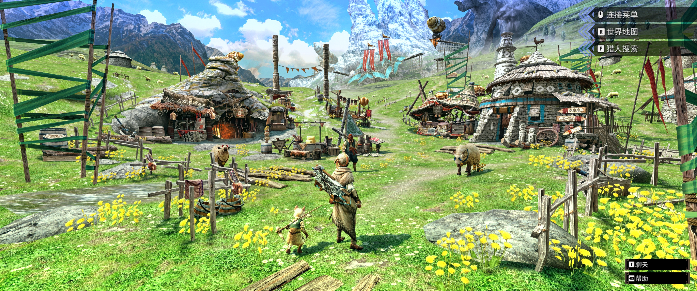
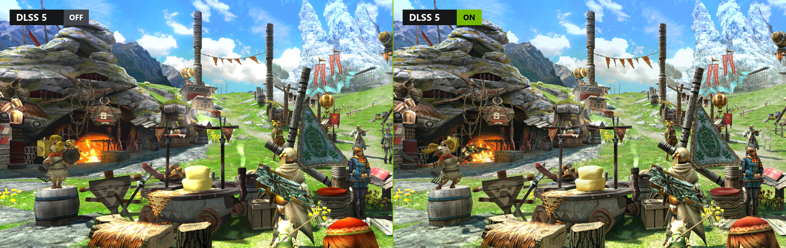
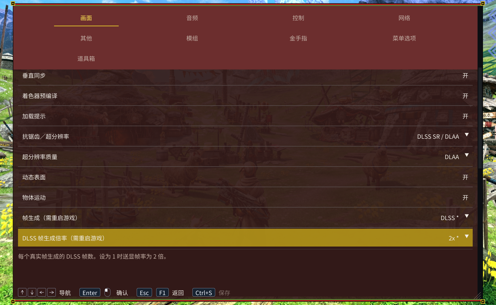

<h1 align="center">MHGURecomp 增强版</h1>

<p align="center"><a href="../README.md">English</a> · <strong>简体中文</strong> · <a href="README.zh-TW.md">繁體中文</a></p>

本项目在 [morerokk/MHGURecomp](https://github.com/morerokk/MHGURecomp) 的基础上添加了**原生键鼠输入与图标支持、超宽屏支持、DLSS 超分辨率和 DLSS 5 神经渲染**。

[VERSION](../VERSION) 记录增强版版本，[UPSTREAM_VERSION](../UPSTREAM_VERSION) 记录对应的上游整合基准。

## 运行要求与安装

- Windows 10／11 64 位，支持 AVX2／FMA 的 CPU 和支持 Vulkan 1.2 的 GPU。基础渲染至少需要 4 GB 内存和 1 GB 显存。
- 自备完整的 Nintendo Switch MHGU 1.4.0 游戏文件，已合并更新。

从 [Releases](https://github.com/dzxrly/MHGURecomp-Enhanced/releases) 下载 `MHGURecomp-Enhancement-win_x86-64.zip`，解压后放入完整的游戏目录：

```text
Windows-MHGURecomp/
  mhgurecomp.exe
  mhgugame.dll
  mhgurecomp-updater.exe
  data/
    exefs/
    romfs/
  mods/Keyboard_Mouse_Input_Auto/
```

保留发行包的全部程序依赖，启动 `mhgurecomp.exe`。首次运行会生成 `mhgurecomp.ini`，并检查游戏版本。基础游戏文件保持不变，修改通过模组加载。

## 超宽屏支持

打开 **F1 → 图形 → 画面比例**。**自动**跟随输出分辨率，也可选 16:10、16:9、21:9、32:10、32:9 和常见超宽分辨率的精确比例。

| 输出分辨率 | 比例预设 |
| --- | --- |
| 2560×1080 | 64:27 |
| 3440×1440 | 43:18 |
| 3840×1600 | 24:10 |

超宽比例保持垂直视野，扩展两侧场景。通过 **HUD 锚点**，可将血条、队友状态和道具栏留在中央的 **16:9** 区域，或移至画面**边缘**。保存后立即生效。预录影片保持源画面的比例。

[](screenshots/zh-cn/ultrawide.webp)

## 图形与神经渲染

- **抗锯齿／超分辨率**提供 FXAA、MSAA、FSR 3.1、FSR 4、XeSS 超分和 DLSS SR／DLAA。开启神经渲染或帧生成时，MSAA 不可用。FSR 4 不可用时会回退到 FSR 3.1。F1 会显示实际使用的后端和渲染分辨率。
- **帧生成**可选 FSR 或 DLSS。修改后端或 DLSS 倍率后，保存并重启。**帧率上限**限制实际渲染帧率。**性能显示**可同时查看送显帧率、渲染帧率和超分状态。

在 F1 中开启 **DLSS 5 神经渲染**（NR）。默认的 `NRRuntime = Auto` 会在 RTX 50 上使用 NVIDIA 原版，在 RTX 40 上使用社区 SM89 兼容版。可在 INI 中通过 `NRRuntime` 手动指定。[运行库文件与来源](../third_party/ngx/README.md)

**神经渲染模型（重启生效）**默认选 A。要用较小的 B 模型，选择后保存并重启。如果 DLL 缺少 B，本次运行使用 A，并保留已保存的选择。F1 的神经渲染状态会显示实际模型。

[](screenshots/dlss5.webp)

两侧均使用 DLAA。右侧使用 A 模型，总体强度为 1，效果层数为 2。

| NR 选项 | INI 配置项 | 默认值 | 范围 |
| --- | --- | --- | --- |
| 模型总体强度 | `NRIntensity` | 0.5 | 0～2 |
| 模型风格 | `NRStyle` | Standard | Standard／Natural／Cinematic |
| 局部结构 | `NRLocalStructure` | 1 | 0～2 |
| 局部色调 | `NRLocalTone` | 0 | 0～2 |
| 皮肤结构 | `NRSkinStructure` | **0** | 0～2 |
| 自动皮肤蒙版 | `NRAutoMask` | **On** | On／Off |
| 效果层数 | `NRLayers` | 1 | **1～5** |

[](screenshots/zh-cn/graphics.webp)

效果层数和强度设置保存后立即生效。第 1～5 层对神经渲染结果与原图的差值分别使用 **1.00、1.25、1.50、1.75、2.00 倍**增益。每个场景帧执行一次模型推理。

## 键鼠配置

### 启用与基础设置

启动时选择手柄或键鼠，选择会保存到 `mhgurecomp.ini`。勾选“不再询问”后，后续启动直接使用已保存的选择；将 INI 中的 `AskInputOnStartup` 改回 `On` 可恢复询问。键鼠对应的配置为：

```ini
[Controls]
InputMode = Keyboard_Mouse_Input

[Mouse]
MouseSensitivity = 1.0
```

默认模式为 `Original`；使用下方键位需切换到 `Keyboard_Mouse_Input`。两种模式均支持手柄。轻弩、重弩、弓自动使用**远程 Ranged**，其余猎人武器和猎猫使用**近战 Melee**。更换装备后键位和提示自动切换，无需重启。

### 启用键鼠提示

发布包已包含 `mods/Keyboard_Mouse_Input_Auto`，在 **F1 → Mods** 启用后重启即可。提示会跟随装备和游戏语言自动切换。保留整个目录，无需另行下载或生成。

### 按键表

| 输入                     | 近战 Melee                        | 远程 Ranged                       |
| ------------------------ | --------------------------------- | --------------------------------- |
| WASD                     | 左摇杆：移动                      | 左摇杆：移动                      |
| 鼠标移动                 | 任务视角                          | 任务视角／武器瞄准                |
| 鼠标左键                 | X：主攻击／拔刀                   | A：射击、确认／交互               |
| 鼠标右键                 | A：副攻击、确认／交互             | R：瞄准                           |
| R                        | R：防御／武器特殊动作             | X：装填／拔刀                     |
| 鼠标侧键5                | R：防御／武器特殊动作             | 未绑定                            |
| F／鼠标侧键4             | Y：收刀／使用道具                 | Y：收刀／使用道具                 |
| E                        | Y：收刀／使用道具                 | R：瞄准                           |
| 左 Shift                 | R：通用奔跑                       | R：通用奔跑                       |
| Space                    | B：闪避、取消／返回               | B：闪避、取消／返回               |
| C                        | X+A：组合攻击                     | X+A：组合动作                     |
| 滚轮上／下               | L+Y／L+A：选择道具                | L+X／L+B：选择弹药或瓶            |
| Q                        | L：道具栏／镜头操作               | L：道具栏／镜头操作               |
| Esc／Enter／小键盘 Enter | ＋：游戏菜单                      | ＋：游戏菜单                      |
| Backspace                | －：减号菜单                      | －：减号菜单                      |
| Tab／鼠标中键            | ZL：切换目标（操作类型1）         | ZL：切换目标（操作类型1）         |
| T                        | ZR                                | ZR                                |
| 1／2／3                  | 方向上／右／下：狩技（操作类型1） | 方向上／右／下：狩技（操作类型1） |
| 方向键                   | 十字方向键                        | 十字方向键                        |
| Ctrl／Alt                | 按下左／右摇杆                    | 按下左／右摇杆                    |
| F1／F2                   | PC 设置／释放鼠标                 | PC 设置／释放鼠标                 |

按键按 QWERTY 键盘的物理位置读取。游戏菜单中近战用右键确认、远程用左键确认，Space 返回；原游戏菜单仍按按钮操作，不支持用鼠标指针点选。按 F2 释放鼠标，点击窗口可重新捕获。

在村庄或任务中按 `/` 聊天，Enter 发送、Esc 取消；可在 **F1 → Controls** 修改聊天键。输入文字时可用 Ctrl+V 粘贴。

### 弓与猎猫

弓自动使用远程预设。收弓时左键保留 A 确认／交互，按 R（游戏 X）拔弓；拔弓后：

| 输入      | 弓操作类型1                | 弓操作类型2                      |
| --------- | -------------------------- | -------------------------------- |
| 鼠标左键  | X：蓄力，松开发射          | 游戏设置对应的 R：蓄力，松开发射 |
| 鼠标右键  | 游戏设置对应的 R：按住瞄准 | X：点击切换瞄准                  |
| 鼠标侧键5 | A：弓副动作                | A：弓副动作                      |

鼠标操作遵循游戏中的弓操作类型和 R/ZR 互换设置，键盘仍按基础表工作；菜单用左键确认。弓目前仍显示基础远程提示，鼠标操作以上表为准。

猎猫使用近战预设：左键攻击，右键蓄力回旋镖；蓄力时按住 R／侧键5可精瞄。拔武器时 R 防御、R+左键上击；收武器时 R+C 防御。滚轮选择支援行动，收武器时 F 使用，拔武器时 R+F 使用，仍需满足原有使用条件与能量消耗。

### 鼠标灵敏度与镜头选项

在 F1 调整 **Mouse sensitivity**，或修改 ini 中的 `MouseSensitivity`（0.1～10）。游戏内的**视角移动速度**调节任务镜头，**准星移动速度**调节弩／弓瞄准及望远镜，均即时生效。普通视角、快速瞄准和第一人称／望远镜的反转选项在游戏内分别设置。

原有射击硬直、入瞄准延迟和招式转向限制继续生效。村庄、固定弩炮和猎猫特殊瞄准仍有游戏原本的转速限制。部分游戏手册页面仍显示手柄插图。

## 设置、文件与联机

按 **F1** 打开设置。**菜单选项**可调整主题、缩放和语言。拖动标签栏移动菜单，拖动右下角调整大小。按 **Ctrl+S** 或手柄顶部面键保存设置。

**Alt+Enter** 或 **F11** 切换全屏，**F12** 截图，**F7** 在可用时切换 MSAA。

进入角色后可在 **F1 → 道具箱** 按名称或编号搜索道具。输入总数并选择**应用数量**，负数表示扣减。编辑器会按已解锁的格数分配堆叠。在游戏内保存才能保留道具修改。

| 内容 | 位置 |
| --- | --- |
| 配置／日志 | 程序旁的 `mhgurecomp.ini`／`log.txt` |
| Windows 存档 | `%APPDATA%\MHGURecomp\save\save_0\` |
| 模组／金手指 | `mods/`／`cheats/` |
| 截图／着色器缓存 | `shots/`／`cache/` |

导入 Switch 存档前备份目标目录，再将自己的 `system`、`system_backup` 放入 `save_0`。

游戏内选择**本地无线通信**。局域网／虚拟局域网可直接发现房间；互联网联机使用兼容客户端、相同房间服务器和可选配对密钥，在 **F1 → Network** 设置。直接主持房间时，默认需要 TCP／UDP 39500 端口可达。

每个模组放入独立的 `mods/` 子目录，在 **F1 → Mods** 启用、排序后重启，后加载的冲突模组优先。MHGU 1.4.0 金手指 `.txt` 放入 `cheats/`，文件名前加 `_` 可禁用。附带 Auto 提示模组跟随装备和游戏语言。怪物血量与集会所／村庄任务选项位于 Misc。若另行提供 `bonus/system` 且 `BonusContent = On`，程序可导入尚未拥有的活动任务、道具包和随从内容。

在 **F1 → Cheats** 中逐项开关金手指，选择 Save 后立即生效，无需重启。主代码保持开启。关闭金手指会在修改同一代码位置的金手指均关闭后恢复原代码；已改变的金钱、物品等数据不会恢复。新增金手指文件后需要重启。

### Forge 插件

将插件的 `romfs/` 放进独立的模组目录。内置的 Forge 1.5.1 兼容层负责加载插件。按 **Insert → Plugin UI** 打开插件设置。

**Damage Numbers r36** 需另行安装，使用原始 `damage_numbers.nro` 及随附资源。兼容层会按实际画面区域换算超宽屏和 DLSS 输出下的数字位置。

## 更新与问题排查

从本仓库下载新版，或使用附带更新器。更新会替换程序、随包 DLSS 运行库和 Auto 提示资源，保留游戏数据、配置、存档和其他模组。

- **游戏版本不符**：使用完整且已合并更新的 Switch 1.4.0 文件，基础资源保持不变。
- **仍显示手柄提示**：选择 `InputMode = Keyboard_Mouse_Input`，启用附带 Auto 模组并重启。
- **DLSS／NR 不可用。** 查看 F1 的实际状态和日志。RTX 40 可以将 `NRRuntime` 设为 `Auto` 或 `SM89`，然后重启游戏。
- **反馈问题**：在 [Issues](https://github.com/dzxrly/MHGURecomp-Enhanced/issues) 提供增强版版本、显卡与驱动、图形配置、复现步骤及复制保存的 `log.txt`。

[开发文档](DEVELOPMENT.md)介绍架构、构建、测试与发布。

## 许可与致谢

项目代码采用 MIT 许可，保留 [LICENSE](../LICENSE) 和[第三方声明](../THIRD_PARTY_NOTICES)。NVIDIA 组件适用独立条款。游戏及生成的游戏代码不在项目许可范围内。本项目与 Capcom、Nintendo、NVIDIA 无关联。
