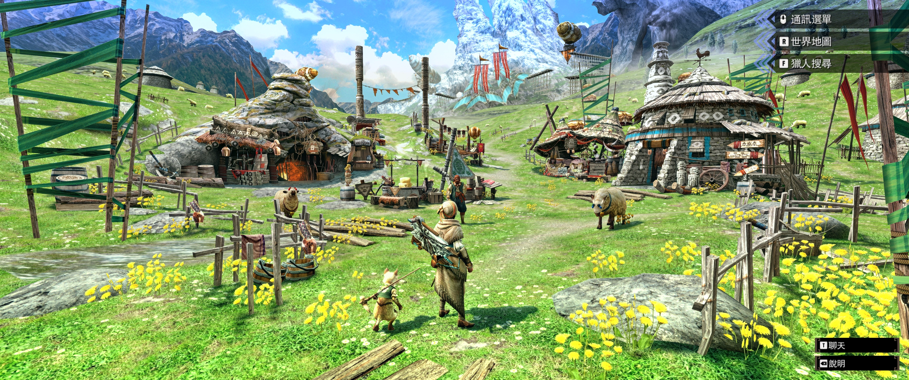
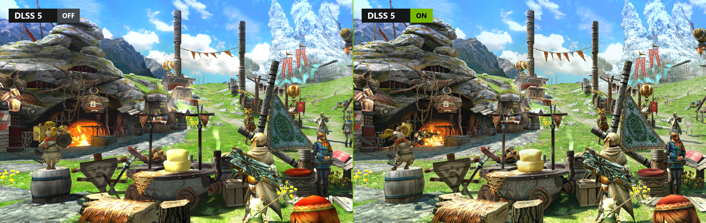
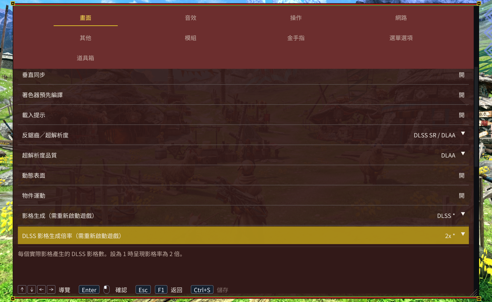

<h1 align="center">MHGURecomp 增強版</h1>

<p align="center"><a href="../README.md">English</a> · <a href="README.zh-CN.md">简体中文</a> · <strong>繁體中文</strong></p>

本專案在 [morerokk/MHGURecomp](https://github.com/morerokk/MHGURecomp) 的基礎上新增了**原生鍵鼠輸入與圖示支援、超寬螢幕支援、DLSS 超解析度和 DLSS 5 神經渲染**。

[VERSION](../VERSION) 記錄增強版版本，[UPSTREAM_VERSION](../UPSTREAM_VERSION) 記錄對應的上游整合基準。

## 執行需求與安裝

- Windows 10／11 64 位元、支援 AVX2／FMA 的 CPU 和支援 Vulkan 1.2 的 GPU。基本算繪至少需要 4 GB 記憶體和 1 GB 顯示記憶體。
- 自備完整且已合併更新的 Nintendo Switch MHGU 1.4.0 遊戲檔案。

從 [Releases](https://github.com/dzxrly/MHGURecomp-Enhanced/releases) 下載 `MHGURecomp-Enhancement-win_x86-64.zip`，解壓縮後放入完整遊戲目錄：

```text
Windows-MHGURecomp/
  mhgurecomp.exe
  mhgugame.dll
  mhgurecomp-updater.exe
  data/
    exefs/
    romfs/
  mods/Keyboard_Mouse_Input_Auto/
```

保留發行包的全部程式相依檔案，執行 `mhgurecomp.exe`。首次啟動會產生 `mhgurecomp.ini`，並檢查遊戲版本。基礎遊戲檔案保持不變，修改透過模組載入。

## 超寬螢幕支援

開啟 **F1 → Graphics → 畫面比例**。**自動**跟隨輸出解析度，也可選 16:10、16:9、21:9、32:10、32:9 和常見超寬解析度的精確比例。

| 輸出解析度 | 比例預設 |
| --- | --- |
| 2560×1080 | 64:27 |
| 3440×1440 | 43:18 |
| 3840×1600 | 24:10 |

超寬比例維持垂直視野，延伸兩側場景。用 **HUD 錨點**將 HUD 留在中央的 **16:9** 區域，或移到畫面**邊緣**。儲存後立即生效。預錄影片維持來源比例。

[](screenshots/zh-tw/ultrawide.webp)

## 圖形與神經渲染

- **反鋸齒／超解析度**提供 FXAA、MSAA、FSR 3.1、FSR 4、XeSS 超解析及 DLSS SR／DLAA。開啟神經渲染或影格生成時，MSAA 無法使用。FSR 4 無法使用時會改用 FSR 3.1。F1 會顯示實際的後端和算繪解析度。
- **影格生成**可選 FSR 或 DLSS。變更後端或 DLSS 倍率後，儲存並重新啟動。**影格率上限**限制算繪影格率。**效能顯示**可同時查看呈現影格率、算繪影格率和超解析狀態。

在 F1 開啟 **DLSS 5 神經渲染**。預設的 `NRRuntime = Auto` 會在 RTX 50 使用 NVIDIA 原版，在 RTX 40 使用社群 SM89 相容版。可在 INI 透過 `NRRuntime` 手動指定。[執行庫檔案與來源](../third_party/ngx/README.md)

**神經渲染模型（重新啟動後生效）**預設為 A。若要使用較小的 B 模型，選擇後儲存並重新啟動。如果 DLL 缺少 B，本次執行會改用 A，並保留已儲存的選擇。F1 的神經渲染狀態會顯示實際使用的模型。

[](screenshots/dlss5.webp)

兩側皆使用 DLAA。右側使用 A 模型，整體強度為 1，效果層數為 2。

| NR 選項 | INI 設定項目 | 預設值 | 範圍 |
| --- | --- | --- | --- |
| 模型整體強度 | `NRIntensity` | 0.5 | 0～2 |
| 模型風格 | `NRStyle` | Standard | Standard／Natural／Cinematic |
| 局部結構 | `NRLocalStructure` | 1 | 0～2 |
| 局部色調 | `NRLocalTone` | 0 | 0～2 |
| 皮膚結構 | `NRSkinStructure` | **0** | 0～2 |
| 自動皮膚遮罩 | `NRAutoMask` | **On** | On／Off |
| 效果層數 | `NRLayers` | 1 | **1～5** |

[](screenshots/zh-tw/graphics.webp)

效果層數和強度設定在儲存後立即生效。第 1～5 層對神經渲染結果與原圖的差值分別使用 **1.00、1.25、1.50、1.75、2.00 倍**增益。每個場景影格執行一次模型推論。

## 鍵鼠設定

### 啟用與基礎設定

啟動時選擇手把或鍵鼠，選擇會儲存至 `mhgurecomp.ini`。勾選「不再詢問」後，後續啟動直接使用已儲存的選擇；將 INI 中的 `AskInputOnStartup` 改回 `On` 可恢復詢問。鍵鼠對應的設定為：

```ini
[Controls]
InputMode = Keyboard_Mouse_Input

[Mouse]
MouseSensitivity = 1.0
```

預設模式為 `Original`；使用下方鍵位需切換到 `Keyboard_Mouse_Input`。兩種模式均支援手把。輕弩、重弩、弓自動使用**遠程 Ranged**，其餘獵人武器和獵貓使用**近戰 Melee**。更換裝備後鍵位和提示自動切換，無需重新啟動。

### 啟用鍵鼠提示

發布套件已包含 `mods/Keyboard_Mouse_Input_Auto`，在 **F1 → Mods** 啟用後重新啟動即可。提示會跟隨裝備和遊戲語言自動切換。保留整個目錄，無需另行下載或產生。

### 按鍵表

| 輸入                     | 近戰 Melee                        | 遠程 Ranged                       |
| ------------------------ | --------------------------------- | --------------------------------- |
| WASD                     | 左搖桿：移動                      | 左搖桿：移動                      |
| 滑鼠移動                 | 任務視角                          | 任務視角／武器瞄準                |
| 滑鼠左鍵                 | X：主攻擊／拔刀                   | A：射擊、確認／互動               |
| 滑鼠右鍵                 | A：副攻擊、確認／互動             | R：瞄準                           |
| R                        | R：防禦／武器特殊動作             | X：裝填／拔刀                     |
| 滑鼠側鍵5                | R：防禦／武器特殊動作             | 未綁定                            |
| F／滑鼠側鍵4             | Y：收刀／使用道具                 | Y：收刀／使用道具                 |
| E                        | Y：收刀／使用道具                 | R：瞄準                           |
| 左 Shift                 | R：通用奔跑                       | R：通用奔跑                       |
| Space                    | B：閃避、取消／返回               | B：閃避、取消／返回               |
| C                        | X+A：組合攻擊                     | X+A：組合動作                     |
| 滾輪上／下               | L+Y／L+A：選擇道具                | L+X／L+B：選擇彈藥或瓶            |
| Q                        | L：道具欄／鏡頭操作               | L：道具欄／鏡頭操作               |
| Esc／Enter／小鍵盤 Enter | ＋：遊戲菜單                      | ＋：遊戲菜單                      |
| Backspace                | －：減號菜單                      | －：減號菜單                      |
| Tab／滑鼠中鍵            | ZL：切換目標（操作類型1）         | ZL：切換目標（操作類型1）         |
| T                        | ZR                                | ZR                                |
| 1／2／3                  | 方向上／右／下：狩技（操作類型1） | 方向上／右／下：狩技（操作類型1） |
| 方向鍵                   | 十字方向鍵                        | 十字方向鍵                        |
| Ctrl／Alt                | 按下左／右搖桿                    | 按下左／右搖桿                    |
| F1／F2                   | PC 設定／釋放滑鼠                 | PC 設定／釋放滑鼠                 |

按鍵按 QWERTY 鍵盤的物理位置讀取。遊戲選單中近戰用右鍵確認、遠程用左鍵確認，Space 返回；原遊戲選單仍按按鈕操作，不支援用滑鼠指標點選。按 F2 釋放滑鼠，點擊視窗可重新捕獲。

在村莊或任務中按 `/` 聊天，Enter 傳送、Esc 取消；可在 **F1 → Controls** 修改聊天鍵。輸入文字時可用 Ctrl+V 貼上。

### 弓與獵貓

弓自動使用遠程預設。收弓時左鍵保留 A 確認／互動，按 R（遊戲 X）拔弓；拔弓後：

| 輸入      | 弓操作類型1                | 弓操作類型2                      |
| --------- | -------------------------- | -------------------------------- |
| 滑鼠左鍵  | X：蓄力，松開發射          | 遊戲設定對應的 R：蓄力，松開發射 |
| 滑鼠右鍵  | 遊戲設定對應的 R：按住瞄準 | X：點擊切換瞄準                  |
| 滑鼠側鍵5 | A：弓副動作                | A：弓副動作                      |

滑鼠操作遵循遊戲中的弓操作類型和 R/ZR 互換設定，鍵盤仍按基礎表工作；選單用左鍵確認。弓目前仍顯示基礎遠程提示，滑鼠操作以上表為準。

獵貓使用近戰預設：左鍵攻擊，右鍵蓄力迴旋鏢；蓄力時按住 R／側鍵5可精瞄。拔武器時 R 防禦、R+左鍵上擊；收武器時 R+C 防禦。滾輪選擇支援行動，收武器時 F 使用，拔武器時 R+F 使用，仍需滿足原有使用條件與能量消耗。

### 滑鼠靈敏度與鏡頭選項

在 F1 調整 **Mouse sensitivity**，或修改 ini 中的 `MouseSensitivity`（0.1～10）。遊戲內的**視角移動速度**調節任務鏡頭，**準星移動速度**調節弩／弓瞄準及望遠鏡，均即時生效。普通視角、快速瞄準和第一人稱／望遠鏡的反轉選項在遊戲內分別設定。

原有射擊硬直、入瞄準延遲和招式轉向限制繼續生效。村莊、固定弩炮和獵貓特殊瞄準仍有遊戲原本的轉速限制。部分遊戲手冊頁面仍顯示手把插圖。

## 設定、檔案與連線

按 **F1** 開啟設定。**選單選項**可調整主題、縮放和語言。拖曳分頁列移動選單，拖曳右下角調整大小。按 **Ctrl+S** 或控制器頂端面鍵儲存設定。

**Alt+Enter** 或 **F11** 切換全螢幕，**F12** 截圖，**F7** 在可用時切換 MSAA。

進入角色後可在 **F1 → 道具箱** 按名稱或編號搜尋道具。輸入總數並選擇**套用數量**，負數表示扣減。編輯器會按已解鎖的格數分配堆疊。在遊戲內儲存才能保留道具修改。

| 內容 | 位置 |
| --- | --- |
| 設定／日誌 | 程式旁的 `mhgurecomp.ini`／`log.txt` |
| Windows 存檔 | `%APPDATA%\MHGURecomp\save\save_0\` |
| 模組／金手指 | `mods/`／`cheats/` |
| 畫面擷取／著色器快取 | `shots/`／`cache/` |

匯入 Switch 存檔前請備份目標目錄，再把自己的 `system`、`system_backup` 放入 `save_0`。

遊戲內選擇**本地無線通訊**。區域網路／虛擬區域網路可直接發現房間；網際網路連線使用相容客戶端、相同房間伺服器和可選配對金鑰，在 **F1 → Network** 設定。直接主持房間時，預設需要 TCP／UDP 39500 連接埠可達。

每個模組放入獨立的 `mods/` 子目錄，在 **F1 → Mods** 啟用、排序後重新啟動，後載入的衝突模組優先。MHGU 1.4.0 金手指 `.txt` 放入 `cheats/`，檔名前加 `_` 可停用。附帶 Auto 提示模組跟隨裝備和遊戲語言。魔物血量與集會所／村莊任務選項位於 Misc。若另行提供 `bonus/system` 且 `BonusContent = On`，程式可匯入尚未擁有的活動任務、道具包和隨從內容。

在 **F1 → Cheats** 中逐項開關金手指，選擇 Save 後立即生效，無需重新啟動。主代碼保持開啟。關閉金手指會在修改同一程式碼位置的金手指均關閉後恢復原程式碼；已改變的金錢、道具等資料不會恢復。新增金手指檔案後需要重新啟動。

### Forge 外掛

將外掛的 `romfs/` 放入獨立的模組目錄。內建的 Forge 1.5.1 相容層負責載入外掛。按 **Insert → Plugin UI** 開啟外掛設定。

**Damage Numbers r36** 需另行安裝，使用原始 `damage_numbers.nro` 及隨附資源。相容層會依實際畫面區域換算超寬螢幕和 DLSS 輸出下的數字位置。

## 更新與問題排查

從本倉庫下載新版，或使用附帶更新器。更新會替換程式、隨包 DLSS 執行庫和 Auto 提示資源，保留遊戲資料、設定、存檔與其他模組。

- **遊戲版本不符**：使用完整且已合併更新的 Switch 1.4.0 檔案，基礎資源保持不變。
- **仍顯示手把提示**：選擇 `InputMode = Keyboard_Mouse_Input`，啟用附帶 Auto 模組並重新啟動。
- **DLSS／NR 無法使用。** 查看 F1 的實際狀態和日誌。RTX 40 可以將 `NRRuntime` 設為 `Auto` 或 `SM89`，然後重新啟動遊戲。
- **回報問題**：在 [Issues](https://github.com/dzxrly/MHGURecomp-Enhanced/issues) 提供增強版版本、顯示卡與驅動、圖形設定、重現步驟與複製保存的 `log.txt`。

[開發文件](DEVELOPMENT.md)介紹架構、建置、測試與發行。

## 授權與致謝

專案程式碼採 MIT 授權，保留 [LICENSE](../LICENSE) 和[第三方聲明](../THIRD_PARTY_NOTICES)。NVIDIA 元件適用獨立條款。遊戲與產生的遊戲程式碼不在專案授權範圍內。本專案與 Capcom、Nintendo、NVIDIA 無關聯。
